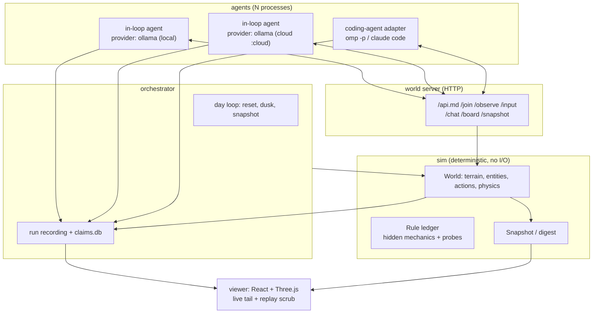

# Whisperwind — an island for machine minds

> Derived from `docs/ideas.md`, constrained to a from-scratch build on the
> hardware in this house. Every performance number below was measured on
> 2026-10-31 against this machine's AI server, not estimated.

## 1. Decisions

| # | Decision | Why | Evidence |
|---|---|---|---|
| D1 | **Simulation core in TypeScript on Node 24 with Rapier 3D (WASM), headless** | Deterministic, snapshot/restore exact, ~1,600× realtime headroom, one language for sim + server + viewer + orchestrator | Rapier 0.21: identical SHA-256 state digest across 3 processes (600 ticks × 30 bodies); `takeSnapshot()`/`restoreSnapshot()` reproduce byte-identical continuation (44,245 B and 33,879 B snapshots, MATCH both times); 3,600 s of sim @60 Hz with 16 bodies in **2.19 s wall** (1,644× realtime); snapshot costs **0.03 ms** |
| D2 | **Server-authoritative world, agents speak HTTP** | Same shape as the paper's setup, so a coding-agent adapter is a ~200-line shim; keeps the sim out of every agent's trust boundary | Paper §2.2: agents act via `POST /input`, observe via `GET /observe` |
| D3 | **Agents are driven in-loop; the model layer is a provider-agnostic config, not a code path** | Models are experimental variables here, so swapping one must be a config edit. One `Provider` interface covers Ollama (locals and `:cloud` models), llama.cpp, and any OpenAI-compatible cloud API. No model is assumed; every capability is probed at startup | Tool calls valid on `qwen3.5:9b`, `gemma4:12b-it-qat`, `glm-5.2:cloud`; one endpoint at `127.0.0.1:11434` serves both local and cloud; embeddings available locally |
| D4 | **Time is turn-synchronised, not wall-clock** | A paused world blocks nobody; slow models cannot starve the world; replay is exact | Design consequence of D1 |
| D5 | **Replay by re-simulation with a per-round digest chain** | One sim hour replays in 2.2 s, so the viewer scrubs instead of storing frames. A terminal digest alone cannot detect a mid-day divergence (measured: a tampered mid-day action produced an identical end-of-day state); the chain can | 1,644× realtime measured; chain sensitivity verified |
| D6 | **Memory is structured claims, not freeform prose** | The paper needed an LLM judge over transcripts to recover what agents knew; claims make adoption, contradiction, and falsification latency SQL queries | Paper §5.2–5.3, §3.3 |
| D7 | **No objectives, no survival, no currency, no task pool** | Eko's signatures of play (self-rules, varied recurrence, make-believe, autotelicity) are the consequence of nothing being at stake. Survival is a loss condition; a task pool is a curriculum | Paper §4.1–4.4 |
| D8 | **Nothing is adopted from Clawblox** | Owner's call; also removes the `max_players = 1`, tmux-only, closed `claude\|codex\|kimi` backend constraints | — |
| D9 | **Every model turn is validated against the action schema, with one repair retry, then a logged `invalid` event** | Providers differ in schema compliance, and a violation is silent: `gemma4` over tool calls returned a missing field and a non-enum action in 8/8 samples, and Ollama accepted `additionalProperties:false` without enforcing it. Sending `tools` + `format` (JSON Schema) fixed it to 8/8 | Measured invalid rates per provider/mode (§5.5) |
| D10 | **Thinking is off by default and toggled per agent config** | On `qwen3.5:9b`, disabling thinking cut a trivial reply from 5.55 s / 367 tokens to **0.31 s / 2 tokens**; a real decision fell from 11.3 s to ~0.9 s. It is the single largest cost lever in the system | Measured on both `/api/chat` and `/v1/chat/completions` |
| D11 | **Belief adoption is detected by an LLM judge, not embeddings** | Cosine similarity cannot separate agreement from contradiction: mean similarity was 0.889 for agreeing pairs and 0.872 for contradicting pairs — a 0.017 separation, below noise | Measured with `embeddinggemma-2` on six labelled pairs |

**Rapier determinism caveat:** verified on this machine and Node build only. Do not
claim bit-exact replay across CPU architectures, Node versions, or Rapier builds.
Pin `@dimforge/rapier3d-compat` exactly and version the snapshot format. Assert the
per-round digest chain (§8), not a per-day terminal digest: a terminal digest was
measured to miss a tampered mid-day action entirely.

**Body identity:** key every entity on its name in `world.json`, never on a Rapier
handle. Handles come back as raw bit patterns that print as subnormals
(`5e-324`, `1e-323`); `String(handle)` is stable but any arithmetic on them is
meaningless. Compute state digests over bodies sorted by handle.

## 2. What this is

A 3D island, a small fixed action set, and 1–5 minds that are told only:
*you live here; leave a record.* No score, no reward, no win condition.

The research question is the one the authors named but did not run:

> **Does exchanging beliefs between agents correct false beliefs, or entrench them?**

The paper supplies the negative result this builds on: agent 7 wrote down
"Place is unreliable, use Throw" and then underperformed *untrained* agents;
agent 12 never recorded the jump-move-combo and never once stood on a platform
in 30 hours; erasing a technique from memory erased exactly that capability and
nothing else (paper §5.2–5.3). Text memory is a capability substrate with a failure
mode, and nobody has yet tested what happens when agents can read each other's
mistakes.

Secondary question, from `ideas.md`: with identical world seeds, how far apart do
different mind *tiers* drift, and does the divergence come from what they can do
or from what they choose to do?

## 2.1 Toolchain (decided, verified)

Node 24 runs `.ts` files directly by stripping types (`node file.ts`), so the project
has **no build step**: no bundler, no `dist/`, no watch mode. Verified on this machine:

| Capability | Result |
|---|---|
| `node main.ts` with cross-file imports | works |
| npm workspaces + `node packages/app/main.ts` importing `@scope/pkg` | works; the symlinked package's `.ts` source is stripped |
| `@dimforge/rapier3d-compat` WASM imported from a workspace package | works |
| `node --test "packages/**/*.test.ts"` | works |
| `node --test <directory>` (no glob) | **broken on Windows** (`MODULE_NOT_FOUND`); always pass a glob |
| `tsc --noEmit` | clean, and exits 2 on error |

Type stripping only erases syntax; it does not transform it. Two consequences, both
enforced by `tsconfig` (`erasableSyntaxOnly`):

- **No `enum`** — use `as const` unions (see `packages/core/src/contracts.ts`).
- **No parameter properties** (`constructor(private x: T)`) — declare and assign.

Both were verified to fail at *runtime* under `node file.ts` while `tsc` reports
`TS1294`. That is why `npm test` runs `tsc --noEmit` first: a type error is not a
build error here, so without that gate a broken file still "runs" until it crashes.

## 3. Architecture



Five packages, one language, no framework beyond the model client:

```
whisperwind/
  packages/
    sim/            # pure: (state, action, tick) -> state. Deterministic. No fetch, no fs.
    world-http/     # Fastify/Hono server wrapping one sim instance; agent + spectator endpoints
    agent/          # OpenAI-compatible client, tool loop, memory files, claim parser
    orchestrator/   # day loop, resets, recording, run manifest
    viewer/         # React + Three.js; live + replay
  worlds/island/    # world.json (seed, terrain params, spawn table) + rules.json
  prompts/          # soul.md, system.md, begin.md, dusk.md
  probes/           # executable assertions for each ledger rule
  runs/             # one directory per run; gitignored
```

`packages/sim` never imports from the others. That keeps the determinism surface
auditable and lets the same module back-test probes without a server.

## 4. The world

### 4.1 Geometry and objects

Reuse the proven island *shape* (it is the smallest world that produced all four
play signatures) and extend it for several bodies:

- Flat base plateau, 11 mesas of varying height, a Peak and a taller Spire.
  Mesas are box colliders, not a trimesh — cheaper, and deterministic in Rapier's
  broad phase.
- 12 cubes per day (the reset restores them), one heavy Rock, one Ring.
- N spawn points on a circle of radius 6, facing the Spire.

### 4.2 Actions (deliberately six)

| Action | Data | Duration |
|---|---|---|
| `MoveTo` | `{position:[x,y,z]}` | `ceil(dist/speed)` ticks |
| `Jump` | `{}` | 18 ticks |
| `Stop` | `{}` | 1 tick |
| `Pickup` | `{position:[x,y,z]}` | 4 ticks |
| `Place` | `{position, rotation?}` | 4 ticks |
| `Throw` | `{direction, speed}` | 2 ticks |

Six verbs, and the paper's entire behavioural repertoire emerged from them. Do
not add a seventh until a milestone needs it. `Give` (hand an item to another
body) is the one candidate, deferred until M3.

### 4.3 Observation

Textual JSON only, no images, no coordinates of other agents' private state:

```json
{"tick": 3600, "day": 2, "player": {"p": [0, 5, 0], "held": null, "last": "MoveTo ok"},
 "nearby": [{"id": 7, "name": "ImpactBlock_3", "t": "block", "p": [3.1, 1.5, 2.0], "size": 1.5}],
 "others": [{"name": "B", "p": [6, 5, 0], "held": "Cube_2"}],
 "board": 3, "chat": 2}
```

`nearby` is radius-filtered and sorted by id so the prompt prefix stays
byte-stable for the model's prompt cache. Measured: llama.cpp reported
`cached_tokens: 4725` out of 4729 on a repeat prompt, so cache discipline is
worth designing for.

### 4.4 Rule ledger

Hidden mechanics are first-class data, not comments, so "did they find it" is a
query rather than a reading exercise:

```json
{"version": 1,
 "rules": [
   {"id": "R1", "name": "throw_inherits_body_velocity",
    "where": "sim/src/actions/throw.ts:41", "params": {"carry": 0.35},
    "observable": "thrown block peak rises when released mid-jump",
    "probe": "probes/R1.mjs", "discovery": {"kind": "action_pattern", "match": "throw within 3 ticks of jump"}},

   {"id": "R2", "name": "rock_impact_spawns_cubes",
    "where": "sim/src/actions/collide.ts:88", "params": {"min_speed": 9, "max_cubes": 6},
    "observable": "impact blocks appear after a hard rock throw",
    "probe": "probes/R2.mjs", "discovery": {"kind": "entity_appears", "name_prefix": "ImpactBlock"}}
 ]}
```

Rules to ship at M0 (each is one constant composing with a base primitive — the
paper's proven template, not scripted easter eggs):

| id | mechanic | status |
|---|---|---|
| R1 | thrown object inherits 0.35× body velocity | discovered by 6/13 Eko agents; designers did not know it was possible |
| R2 | rock impact above 9 m/s spawns 1–6 cubes | deliberate, discovered by 12/13 |
| R3 | ring placed at spawn; walking off the edge respawns you inside it → "wearing" | emergent, no code; ledger entry kind `emergent` |
| R4 | *new*: two cubes placed within 0.4 u on an incline transmit a push up to a threshold angle | new, no external affordance, discoverable only by experiment |
| R5 | *new*: a thrown object that lands on a mesa ≥ 12 u keeps a small residual bounce | new; tests whether agents notice location-dependent physics |

`probes/*.mjs` are executed by the test suite; a rule whose probe fails is a
dead ledger entry, which is the only way to stop this table from drifting from
the code.

## 5. Agent runtime

### 5.1 Provider layer (no model is assumed)

Every agent points at a `provider` entry; nothing in the sim, the orchestrator, or
the viewer knows which model is behind it. Swapping a mind is a config edit.

```yaml
# worlds/island/models.yaml
providers:
  ollama:
    kind: ollama               # native /api/chat, /api/embed
    baseUrl: http://127.0.0.1:11434
    capabilities: { tools: probe, thinking: true, schema: format }
  llamacpp:
    kind: openai               # /v1/chat/completions
    baseUrl: http://192.168.40.247:8080/v1
  cloud:
    kind: openai
    baseUrl: ${CLOUD_BASE_URL}
    apiKey: ${CLOUD_API_KEY}

agents:
  - name: A
    provider: ollama
    model: glm-5.2:cloud       # cloud through the local ollama
    think: false
  - name: B
    provider: ollama
    model: qwen3.5:9b          # local, this machine
    think: false
  - name: C
    provider: llamacpp
    model: qwen3.6-35b-a3b     # local, AI server
    think: true
```

**Capabilities are probed, not configured by hand.** At run start the orchestrator
sends one tiny request per `(provider, model)` and records what came back:
tool-call support, schema enforcement, streaming shape, thinking toggle, context
window, TTFT. The probe result is written into `manifest.json` so a run is
self-describing and a model that changes behaviour is caught, not discovered late.

Three provider quirks are known today and are handled in one place, the adapter:

| Quirk | Evidence | Handling |
|---|---|---|
| `think` is an Ollama-native flag; through `/v1` it is silently ignored | `think:false` on `/v1`: 937 tokens, 13.9 s. On `/api/chat`: 2 tokens, 0.31 s | always use native `/api/chat` for Ollama |
| Cloud models can return NDJSON even with `stream:false` | `glm-5.2:cloud` returned 11 JSON lines with `stream:false` | adapter parses either shape |
| Some models wrap JSON in code fences, drop required fields, or rename enum members | `glm` returned a fenced `{"action":"look"}`; `gemma4` returned `{"position":[2,1,3]}` (no `type`) and `"type":"move_to_ring"` | strip fences, then validate; one repair retry (D9) |

### 5.2 Agent loop

Tools exposed per turn:

- `observe()` → §4.3 payload.
- `act(type, args)` → executes in the sim, returns new observation.
- `board.post(text)` / `board.read(after)` → the commons.
- `chat.send(text)` / `chat.read(after)` → in-world proximity chat.
- `memory.append(summary, detail)` → appends to `EPISODIC.jsonl`.
- `memory.claim(claim)` → validated claim record (§6).
- `run(code)` → *deferred to M1–M2* (see §11), executes a JS snippet in a sandbox
  with only the world base URL reachable. Measured justification: real Eko agents
  wrote Python scripts that issued many `/input` calls in a burst — 7 bursts carried
  all 233 actions of hour 10 — and that is how they laid patterns, built the ten-pin
  triangle, and spelled their names. Until it exists, a decision emits an action
  *sequence* instead, which covers single-object work.

Prompt assembly: a **stable prefix** (system + SOUL + semantic-memory digest) and a
**volatile tail** (current observation). Stable prefix first so provider-side prompt
caching can hit; measured on llama.cpp (`cached_tokens: 4725/4729`), and Ollama
reports cache hits too.

Decision step: one request per round, with schema-constrained decoding where the
provider supports it (§5.5), then validate → execute → append the observation. The
agent may continue within its decision (a short action sequence); the round ends
when all agents have either acted or yielded.

**Thinking is off by default.** With it on, capture the model's reasoning text into
the agent's private journal — it is the internal monologue `ideas.md` asked for —
but never feed it back into the conversation. Where the provider emits reasoning as
a separate field (`reasoning_content`, `thinking`), it is not charged to the
visible transcript; where it is inline, it must not be parsed as an action.

### 5.3 Coding-agent adapter (optional, flagship comparability)

Point an existing coding agent at `GET /api.md` and the same HTTP loop, for runs
comparable to the paper's (their agents had a real shell, real files, and wrote real
programs). Two implementations: `omp -p` per turn (verified here: 3.3 s for a trivial
turn) or long-lived RPC (`omp --mode rpc`) with prompts over JSONL.

This adapter is *not* the default: it is expensive per turn, harder to make
reproducible, and unavailable for local weights. It is also the one place where a
provider swap is not a config edit, which is why it stays optional.

**Sandboxing is not optional.** The authors observed agents reading the world
source, finding parallel runs, and writing notes about being tested. Run the
adapter's shell in a container on the Debian box with egress limited to the world
URL, and keep `packages/sim`, `worlds/`, and `runs/` outside the mount.

### 5.4 Roles: an assignment, not an architecture

`ideas.md` proposed local-as-labourer, cloud-as-elder. The paper's data says play
propensity tracks model tier (Opus scored ≈5× Haiku on every behavioural signature;
Haiku agents ran 10 hours instead of 30), so a small local model will idle and emit
near-empty turns. That is a finding to measure, not a role to bake in.

So roles are a per-run config, and the default experiment keeps one model per arm:

| arm | models | purpose |
|---|---|---|
| replication | one strong cloud model for all agents | comparable to the paper |
| tier divergence (H4) | same model family, different sizes, if available | isolate size from provider |
| local-only | `qwen3.5:9b`, `gemma4:12b-it-qat`, `qwen3.6-35b-a3b` on the AI server | what is achievable with zero API cost |
| asymmetric | strong cloud + small local | test whether a weak mind can execute a strong mind's written recipe — the labourer idea, made measurable |

Do not average metrics across tiers; report per arm. The interesting comparison is
within an arm, between seeds.

### 5.5 Validating model output (measured)

The adapter validates every decision against the action schema, retries once with
the validation error appended, then records an `invalid` event and lets the agent
lose that turn. Measured invalid-output rates, 8 samples per cell, same prompt:

| model | tools only | `format` only | tools + `format` |
|---|---|---|---|
| `qwen3.5:9b` | 0% | 0% | 0% |
| `gemma4:12b-it-qat` | **100%** | 0% | 0% |
| `glm-5.2:cloud` | 0% | ignored (model returns prose) | 0% |

Two lessons that shape the adapter:

1. **`tools` alone is not enough.** Gemma4 returned `{"position":[2,1,3]}` — missing
   the required `type` — and `{"type":"move_to_ring"}`, an enum violation. No error
   was raised by any layer. Constrained decoding via `format` fixed it to 8/8.
2. **`format` alone is not portable.** `glm-5.2:cloud` ignored it and answered in
   prose wrapped in code fences, which then failed to parse — observed again in the
   M0 loop, where that agent silently did nothing for five rounds. Sending both is
   the only combination measured to work on all three.

Cost of the safety net: constrained decoding is free at these prompt sizes
(545–735 ms versus 827 ms unconstrained on gemma4) and it removes an entire class of
silent corruption, so it is on for every provider that accepts it.

**End-to-end check of the whole layer** (probe → constrained decode → validate →
repair, all three providers, mixed in one round):

| model | probe: schema enforced | decision attempts | valid | turn ms |
|---|---|---|---|---|
| `qwen3.5:9b` | yes | 1 | yes | 706 |
| `gemma4:12b-it-qat` | yes | 1 | yes | 1,377 |
| `glm-5.2:cloud` | **no** | **2** (repair) | yes | 510 |

A full three-agent round across a local 9B, a local 12B, and a cloud model through
one endpoint took **1.95 s wall**, all actions valid. The probe correctly predicted
which model would need repair, and the repair recovered it in one retry — which is
why the probe result belongs in `manifest.json`: it tells you at run start which arms
will cost retries.

## 6. Memory and beliefs

Two files per agent, as in the paper, but the semantic one is parseable:

```
EPISODIC.jsonl   append-only: {t, day, summary, detail, action_ref}
SEMANTIC.md      claims, rendered for humans; the source of truth is claims.db
```

Claim record:

```yaml
- id: c_7f3a
  claim: "Place stacks reliably when the drop is within 0.2u of the target centre"
  kind: verified        # verified | fact | hypothesis | mistake
  confidence: 0.8
  evidence: [ep_0193, ep_0204]
  source: self          # self | agent:B | board:post_12
  status: active        # active | refuted | superseded
```

```sql
CREATE TABLE claims (
  id TEXT PRIMARY KEY, agent TEXT NOT NULL, day INTEGER NOT NULL,
  text TEXT NOT NULL, kind TEXT NOT NULL, confidence REAL,
  source TEXT, source_agent TEXT, source_claim TEXT,
  evidence TEXT,                 -- JSON array of episodic ids
  inferred_by TEXT,              -- null when declared; else judge model id
  status TEXT NOT NULL,          -- active | refuted | superseded
  created_tick INTEGER, retired_tick INTEGER
);
```

Why this is worth the schema work: adoption and correction become queries.

- **Adoption**: a claim whose `source_agent` is another agent. Agents cite the
  source claim id when they take a belief from the board, so this is a declared
  relationship rather than an inferred one.

  Do not infer adoption with embeddings. Measured with `embeddinggemma-2` on six
  labelled sentence pairs: mean cosine similarity 0.889 for agreeing pairs, 0.872 for
  contradicting pairs — a 0.017 gap, smaller than the variance between individual
  pairs (one contradicting pair scored 0.952, higher than either agreeing pair). A
  cosine threshold would classify contradictions as agreement. Where adoption must
  be inferred rather than declared, use the judge model on the pair, and record the
  judge's verdict and model in the claim row so the inference is auditable.

  Embeddings remain useful for grouping duplicate claims and for the viewer's
  claim-graph layout, where a wrong edge is cosmetic, not a measurement.
- **Falsification latency**: `retired_tick - created_tick` for claims moved to
  `refuted` by a failed `probe`-backed test. The paper's agent 7 never falsified
  its Place belief in 30 hours; that is the number to beat.
- **Entrenchment**: an adopted false claim that survives longer than the same
  claim held alone.

## 7. The day loop

Wall clock is irrelevant; a day is a **budget of decisions per agent** (default 200,
configurable), which also implies a sim-time length. Budget the decision count, not
the sim clock: turn latency, not physics, sets the wall cost.

A 200-decision day costs 200 × (round latency). Round latency was measured at both
ends of the range, so the planning number depends on which arm is running:

| arm | round latency | 200-decision day | 5-day × 3-seed study |
|---|---|---|---|
| local ollama models (measured mixed round) | 1.95 s | ~6.5 wall-min | ~1.6 wall-h |
| llama.cpp on the AI server, 3-way contention | 5.7–11.8 s | 19–39 wall-min | 4.8–9.8 wall-h |

A 20-sim-minute day would instead need ~2,100 rounds — ~7 wall-hours at the slow
end — for no behavioural gain. Note the asymmetry: the sim runs 1,600× faster than
real time, while the models run at roughly real-time conversational speed. Decision
count, not physics, is the budget.

Durations are physical, derived from distance and speed — never constant ticks:

| Action | Duration | Typical |
|---|---|---|
| `MoveTo` | `ceil(distance / 4.5 m/s / dt)` | 4.5 s for a 20 u walk, 0.9 s for a 4 u step |
| `Jump` | 30 ticks | 0.5 s airborne |
| `Stop` | 1 tick | — |
| `Pickup` | 120 ticks | 2 s reach + grab |
| `Place` | 120 ticks | 2 s |
| `Throw` | 60 ticks | 1 s wind-up |

Mean ≈ 0.57 s sim per action, so 200 decisions ≈ 1.9 sim-minutes. That is *short*
relative to the paper's hour, so calibrate the budget against what Eko actually did.
Measured from the released recordings (agent 9, four sampled hours):

| hour | world actions | actions/min |
|---|---|---|
| 01 | 240 | 4.0 |
| 05 | 446 | 7.4 |
| 20 | 491 | 8.1 |
| 30 | 368 | 6.1 |
| mean | — | 6.4 (≈382/hour) |

But those 382 actions/hour arrived in **~7 bursts**, not 382 decisions. In hour 10,
233 actions had a median inter-action gap of 7.5 s, a p90 of 32 s, a maximum of
485 s, and only 1 of 11 five-minute windows contained no action — the agent spends
minutes writing a script, then executes a batch. Transcript tool-call counting
undercounts world actions ~6× for the same reason (39 counted vs 233 actual in hour
10), so never estimate behaviour from transcripts alone.

Consequences for this design:

- A "decision" is a burst, not an action. Budget **decisions (≈200)**, and let one
  decision emit an action sequence — which the round loop below already permits.
- The paper's 30 h at ~7 bursts/hour is ~210 bursts per agent, so **200
  decisions/day is the right order of magnitude for one day**. A 5-day run therefore
  gives each agent roughly 5× the decision count of one of the paper's 30-hour runs,
  not a comparable total — it is a longer childhood, which is fine for H2 but must be
  stated when comparing activity counts.
- Batch execution is the affordance worth preserving: it is why agents could lay a
  31-cube name, a clock face, or a ten-pin triangle. Without sequences or a script
  tool, most of Eko's repertoire is unreachable — this is the strongest argument for
  `run(code)` in §5.1.

Turns synchronise at round boundaries so a slow model cannot starve the world and a
fast one cannot out-act the others:

```text
for day in 1..D:
    world.restore(canonical(seed, day))      # geometry, items, positions
    for agent in agents: agent.wake(summary_of_memory)
    for round in 1..decision_budget:
        acts = [a.decide(observation) for a in agents]   # barrier, one LLM call each
        world.advance(max(duration(acts)))
        record(round, observations, acts)
        if round == decision_budget - 20: deliver(dusk)
    world.checkpoint(day); freeze_memory(day)
```

An agent that wants more than one action per decision (walk, then pick up, then
carry) spends its own decision budget on it; a single decision may emit a short
action sequence, executed atomically within one round. This is what makes
"walk a route and lay a pattern" possible without a scripting language.

Reset semantics, copied deliberately: geometry resets, memory persists. It bounds
state, gives a day cycle, and produced Eko's best moments — noticing that the
stone forest would vanish and walking it one last time. A never-reset colony ends
with the ring in the ocean.

## 8. Recording and replay

One run directory:

```
runs/<run_id>/
  manifest.json        # config, seeds, model table, code versions, git sha
  events.jsonl         # one line per round: actions, observations, tool calls, tokens
  checkpoints/day-N.snap   # Rapier snapshots (132 KB at island scale, 80 bodies)
  agents/<name>/workspace/    # memory files as of each day's end
  agents/<name>/turns/        # full prompt + response per turn
  claims.db
  digest.json          # final state digest per day
```

Replay = restore day checkpoint + re-apply `events.jsonl` inputs. Faster than real
time by three orders of magnitude, so the viewer can scrub by re-simulating
instead of storing frames.

**A terminal digest per day is not sufficient.** Measured: tampering with a
mid-day action left the end-of-day state byte-identical, because a later `MoveTo`
teleports the body and overwrites the earlier position. Only the rolling chain
caught it. So `events.jsonl` carries a per-round state hash chained into a running
digest:

```jsonl
{"round":10,"agent":"A","action":{"type":"MoveTo","position":[8,5,0]},"state":"6f2a…","chain":"a036…"}
```

Replay asserts the chain after every round, and the first mismatching round is the
replay's failure point. Without this, a replay that diverges mid-day and reconverges
looks perfect and the viewer silently renders physics that never happened.

```
digest.json            { day, rounds, terminal_state, chain }
events.jsonl           per-round { …, state, chain }
```

```sql
-- events.jsonl lines mirror this, for queries
CREATE TABLE rounds (run TEXT, day INT, round INT, sim_ms INT, agent TEXT,
                     action TEXT, args TEXT, ok INT, tokens INT);
```

## 9. Viewer

React + Three.js against the same spectator payload the sim emits, served as SSE.
One scene renderer, two transports (live, replay) — because the payload is
identical, live/replay is a client state change, not a second pipeline.

Panels that matter more than the 3D view:

1. **Timeline** of activity labels per agent per day (build / climb / pattern /
   sport / experiment / rest). Label with a cheap model over the turn transcript,
   fixed taxonomy, exactly as the paper did — but stored, so it is comparable
   across runs.
2. **Claim graph**: nodes are claims, edges are adoption and contradiction; colour
   by `kind`, size by surviving days. This is the figure the paper leaves open.
3. **Heatmap** of agent positions per day (the paper's Figure 3D/E; agent 12's
   absence from elevated platforms was the clearest failure signal).
4. **Trajectory scrubber**: pick a tick, jump cameras to each agent's viewpoint.

## 10. Experiments

| id | hypothesis | design | primary metric |
|---|---|---|---|
| H1 | replication: self-directed activities appear without objectives | 3 agents × 5 days, canonical seed | activity labels/day; play-signature rubric score |
| H2 | belief exchange corrects false beliefs | seeded false board post ("Place cannot stack; use Throw") × {isolated, shared-board} × 3 seeds | falsification latency; adoption rate; held-out tower score |
| H3 | memory ablation is selective | delete all mentions of one rule from one agent's memory at day 3 | target goal score vs 4 controls |
| H4 | tier divergence | same seed, same memory, two models of different capability from the same provider family | position heatmap divergence; action-mix distance; idle rate |

Idle rate — world actions per agent-day, and the fraction of turns that end without
an action — is the cheapest early warning that a model is not playing. The paper
saw agents answer continuation prompts with a bare ".". Log it from day one.

Held-out goals, for H2/H3 only (never visible during play): tallest tower, most
objects on the Spire, fastest block onto the Spire without touching a platform.
Reuse the paper's four for comparability.

Honesty about statistics: n = 3 per cell is descriptive, not inferential. Report
effect sizes and the raw per-run table; do not run a t-test on three seeds.

## 11. Milestones

| M | Deliverable | Acceptance |
|---|---|---|
| **M0** | sim + world + HTTP + one in-loop agent, one day | `npm run replay runs/<id>` reproduces the per-round chain in `digest.json` and stops at the first mismatching round; one agent completes a 200-decision day with ≥1 non-`rest` activity label |
| **M1** | viewer: live view, replay scrub, timeline | open the run in a browser, scrub to any tick, cameras follow each agent |
| **M2** | 3 agents, commons board, seeded false belief | a claim authored by agent A appears with `source_agent: A` in agent B's `claims.db`; falsification latency recorded |
| **M3** | ablation + held-out goals + N seeds | H2/H3 tables produced from `runs/` with no manual transcription |
| **M4** | writeup + rule ledger filled in | every ledger rule has a passing probe and a measured discovery rate |

Sequencing of the two batching affordances, because the measured data says batching
is where Eko's repertoire came from:

- **M0**: a decision may emit an *action sequence* (walk → pick up → walk → place),
  executed within one round. No code execution. This covers single-object work and
  is enough for M0's acceptance.
- **M1–M2**: add `run(code)` only when a run shows an agent trying to express a
  batch that sequences cannot carry (a 31-cube pattern, a ten-pin triangle). It is a
  sandbox and a security surface; add it with a measured reason, not in advance.

Do not build at all before a milestone needs it: a scripting language, a GUI toolkit,
netcode, persistence beyond `events.jsonl`, a plugin system, or a second world.

## 12. Risks

| Risk | Mitigation |
|---|---|
| Rapier determinism breaks across rebuilds | pin exact version; version snapshots; per-round chain assertion on replay, not per-day |
| Replay silently diverges and reconverges | per-round chain; the first mismatching round is the failure point; verified that a day-level digest would miss it |
| Local model play propensity is low (paper: Haiku ≈ 1/5 Opus) | cloud flagship for the headline run; local for breadth and seeds; report per arm, never averaged across tiers |
| Model output is silently malformed | schema-constrained decoding plus validation and one repair retry (§5.5); measured 100% failure without it on gemma4 |
| Provider API drift (flags ignored, stream shape changes) | capability probe at run start, recorded in `manifest.json`; the run states what it verified |
| AI server serves one model at a time, 3 slots | schedule agents of the same model together; a model swap is a run boundary, not a mid-run event |
| A model's behaviour changes between runs | pin model ids and record them plus the probe result; never compare runs across an unpinned id |
| Agent turn latency dominates (§13) | rounds synchronise; keep thinking off; a 2 s round makes a 200-decision day ~7 wall-minutes, a 12 s round ~39; cap simultaneous agents at the AI server's 3 slots |
| Sandbox escape / experiment awareness | shell only in a container on the Debian box with egress restricted to the world; sim source and `runs/` outside the mount |
| Subscription quota for long autonomous runs | run 5 days × 200 decisions first (1.6–9.8 wall-h for 3 seeds depending on arm); measure tokens/agent-day before committing to a long run |
| Claim extraction drifts into an LLM-judging rabbit hole | `memory.claim` validates shape at write time; malformed claims are rejected with the schema in the error |

## 13. Measured throughput budget

Measured 2026-10-31. Two machines: this Windows box (ollama 0.40.13 at
`127.0.0.1:11434`) and the Debian AI server (llama.cpp at `192.168.40.247:8080`).

| Path | Measurement |
|---|---|
| Sim advance | 1 sim hour @60 Hz, 16 bodies: 2.19 s wall (1,644× realtime); snapshot 0.03 ms |
| Snapshot size | 33.9 KB (30 bodies) → 132 KB (80 bodies, island scale) |
| Local turn, thinking **off** | `qwen3.5:9b`, 40-entity observation, constrained decoding, streamed: TTFT 859 ms, total **1.44 s**, schema-valid |
| Local turn, thinking **on** | same prompt, unconstrained: 11.3 s and 524 completion tokens for the same decision |
| Local turn, 12B | `gemma4:12b-it-qat`, same prompt: TTFT 1.23 s, total **1.98 s**, valid only with `format` |
| Cloud turn via ollama | `glm-5.2:cloud`, same prompt: TTFT 586 ms, total 1.25 s (non-streamed path), valid |
| Mixed concurrency | 3 simultaneous turns across a local and a cloud model through the same endpoint: **1.14 s wall**, 2/3 schema-valid before the fix in §5.5 |
| Thinking toggle cost | 2 tokens / 0.31 s (off) vs 367 tokens / 5.55 s (on) for a trivial reply: **18×** |
| AI server | `qwen3.6-35b-a3b` loaded, ctx 262,144, `--parallel 3`; 3.8–11.8 s/turn at 4.7k prompt tokens, cache hit 4,725/4,729 |
| Embeddings | `embeddinggemma-2` (768-d) 16.1 s for 2 strings cold; `nomic-embed-text` 24.6 s |
| Storage | events + memory ~1 MB per agent-day; checkpoints 34–132 KB per day |

The bottleneck is model latency, and it is now small enough that a 200-decision day
is minutes, not hours: at a 2 s round a 3-agent day costs ~7 wall-minutes, at 6 s it
costs ~19, at 12 s ~39. That spread is the argument for provider-agnostic
configuration — the same experiment runs in an afternoon locally or over a day
against a frontier API, with identical code and a different `models.yaml`.

## 13.1 Verification log

Run on 2026-10-31; throwaway scripts, not committed.

| Claim in this plan | How it was checked | Result |
|---|---|---|
| Rapier is deterministic | SHA-256 over all body transforms after 600 ticks, three separate processes | identical digest each time |
| Snapshot/restore is exact | snapshot at tick 300, continue 300 more; restore and continue 300 more | MATCH (44,245 B snapshot) |
| **M0 acceptance is achievable** | build world → 30 rounds × 90 actions → `events.jsonl` + `day-1.snap` + `digest.json`; then replay from scratch re-applying events, and separately restore the snapshot | both digests equal the recorded day digest (`2b756a1d…`), `M0_acceptance: PASS` |
| Snapshot restore preserves body handles | compare handle iteration order before/after restore | same order, same set |
| Same events replay identically | run the same 30-round, 90-action day twice, compare per-round hashes and the chained digest | identical chain (`a036121f…`), all 30 per-round hashes equal |
| A terminal digest is blind to mid-day divergence | tamper with one agent's action at round 10, then compare final state and chain | final state **equal** (later teleport overwrites it), chain **differs**, divergence visible at round 10 |
| A terminal digest does catch a final-action tamper | tamper with the last action | final state differs, chain differs |
| Physics is non-trivial in the M0 world | digest before vs after 6 steps | differs (bodies actually move; the digest is not a constant) |
| Mid-run restore reproduces the tail | snapshot at round 15, restore, replay rounds 15–30 | tail digest matches |
| Claim schema answers the research questions | `node:sqlite` (built into Node 24, no dependency): seed an adopted false claim, a refutation, a survivor; run adoption / falsification-latency / entrenchment / recursive propagation queries | all four queries return the expected rows; propagation depth computed by recursive CTE |
| Local model emits valid tool calls | `POST /v1/chat/completions` with a 6-action `input` tool | `finish_reason: tool_calls`, well-formed arguments |
| Local model can disable thinking | `chat_template_kwargs.enable_thinking=false` vs default | on: 64 reasoning-only tokens, empty `content`, `finish_reason: length`. off: `hello`, 2 tokens |
| Prompt caching works on this server | repeat the same prompt | `cached_tokens: 4725` of `4729` |
| Action rate of real Eko runs | `inputs` table of released `recording.clawrec` (agent 9, hours 01/05/20/30) | 240/446/491/368 actions per hour → 6.4 actions/min mean |
| Agents batch actions rather than acting once per turn | gap statistics over hour 10's 233 inputs | 7 clusters, median gap 7.5 s, max 485 s; transcripts show Python scripts issuing many `/input` calls |
| Transcript counting undercounts actions | same hour, transcript vs recording | 39 bash `/input` calls counted vs 233 actual actions (~6×) |
| Cloud path works headless | `omp -p "Say exactly: SMOKE_OK" --model anthropic/claude-haiku-4-5` | `SMOKE_OK` in 3.3 s |
| One endpoint serves local and cloud models | `GET :11434/v1/models` and `/api/chat` on both `qwen3.5:9b` and `glm-5.2:cloud` | 26 models listed, both classes respond |
| Local models can emit tool calls | native `/api/chat` with a tool, `think:false` | `qwen3.5:9b` 912 ms; `gemma4` 983 ms; `glm-5.2:cloud` 827 ms |
| `think` only works on the native endpoint | `think:false` on `/v1` vs `/api/chat` | `/v1` ignored it (937 tokens, 13.9 s); native obeyed (2 tokens, 0.31 s) |
| Ollama cloud can return NDJSON regardless of `stream:false` | `glm-5.2:cloud`, `stream:false` | 11 JSON lines instead of one object |
| Tool-call schemas are not enforced | `gemma4` over `tools` only, 8 samples | **100% invalid**: missing required `type`, and enum violation `"move_to_ring"` |
| `format` (JSON Schema) enforces the schema | same 8 samples with `format` | 0% invalid on gemma4, qwen3.5, glm; cost 545–735 ms vs 827 ms unconstrained |
| `format` alone is not portable | `glm-5.2:cloud` with `format` but no tools | ignored it; returned prose in a code fence |
| Embeddings cannot detect contradiction | `embeddinggemma-2`, 6 labelled pairs | agree mean 0.889 vs contradict mean 0.872; gap 0.017 |
| Realistic agent turn is fast | 40-entity observation, streamed, constrained | qwen3.5 1.44 s (TTFT 859 ms), gemma4 1.98 s, glm-5.2 1.25 s |
| Provider layer works end to end | reference adapter: capability probe → constrained decode → validate → repair, three providers | probe predicted glm needs repair; all 3 valid; mixed 3-agent round **1.95 s wall** |
| **M0 runs with three different providers at once** | real loop: Rapier world + `glm-5.2:cloud`, `qwen3.5:9b`, `gemma4:12b-it-qat`, 5 rounds, 228 sim ticks | every decision schema-valid, ~1.8 s/round, `events.jsonl` + snapshot + digest written |
| **M0 acceptance passes on that run** | replay from scratch twice, plus snapshot at round 2 → restore → replay tail | `rerun_identical: true`, all tail hashes match, terminal `b9296a8f…`, **PASS** |
| `format` alone silently fails on glm | M0 loop with `format` only | agent A returned prose + `{"act":"MoveTo","p":[…]}`; no parseable action, so it never acted. Fixed by sending `tools` + `format` together |

Notes from running these:

- **Replays must be asserted per round, not per day.** This is a correctness
  requirement, not a nicety: the terminal-state control above failed to detect a
  tampered mid-day action.
- **Digest the bodies by sorted handle**, not by iteration order. Order is stable
  across restore today, but sorting makes the digest insensitive to any future
  change in set iteration and costs nothing.
- Rapier exposes rigid-body handles as raw bit patterns printed as subnormals
  (`5e-324`, `1e-323`). Do not compare them as floats or interpolate them into
  logs; `String(handle)` is stable, arithmetic on them is not meaningful. Name
  bodies in `world.json` and key everything on the name.

## 14. Open items

1. Decision budget: 200/agent/day is anchored to the paper's ~210 bursts per
   30-hour run, so it is right for one day but gives a 5-day run ~5× that history.
   It controls behavioural richness and wall cost linearly; fix it after H1 by
   comparing activity labels/day at 200 vs 400.
2. Adoption detection is declared, not inferred (D11). Agents must cite the source
   claim id; if a model refuses to cite, that is itself a result worth recording
   rather than papering over with a similarity threshold.
3. Third local model for the diversity arm: `gemma4:12b-it-qat` and `qwen3.5:9b` are
   both verified working here; add `qwen3.6-35b-a3b` on the AI server or a cloud
   model once one comparison day shows they differ.
4. Flagship replication arm: pin whatever model is current at run time, and record
   the id plus the probe result. There is no need to match the paper's exact model
   unless the goal shifts from "does this replicate" to "is this the same number".
5. Whether `run(code)` is needed at all. With `format`-constrained decisions and
   multi-action sequences, a competent model may reach the same repertoire without a
   sandbox in the loop. Decide from M1 transcripts, not in advance.
6. Context budget for long days: a 200-decision day with 40-entity observations is
   roughly 200 × 1.5k tokens of volatile context. Compaction or observation
   summarisation will be needed before 5-day runs; measure at M2.
